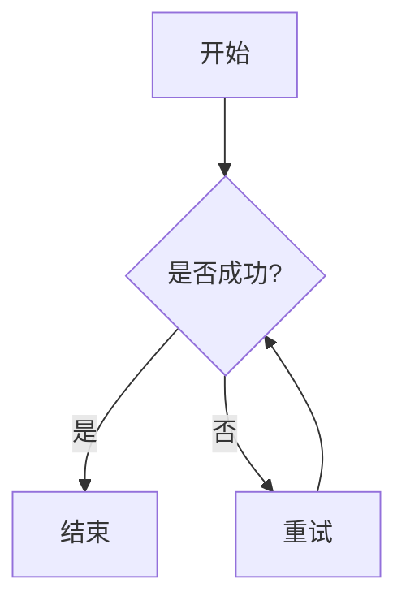
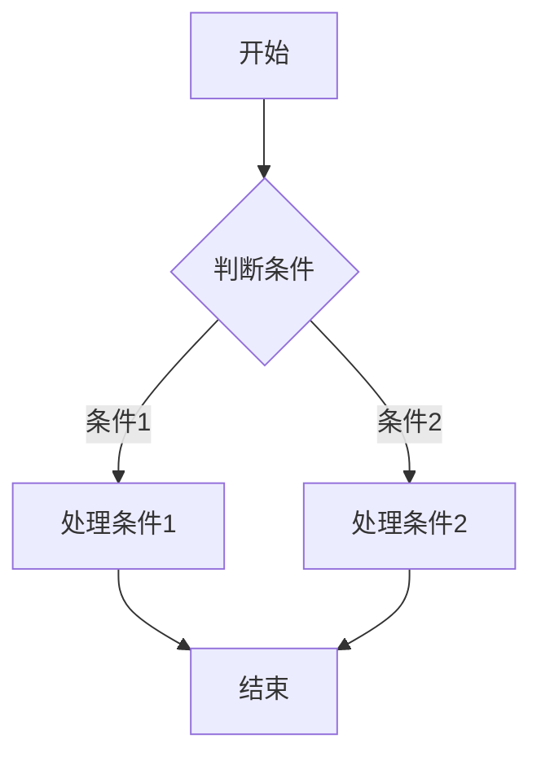
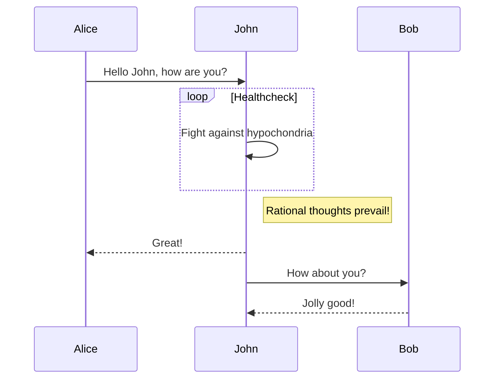
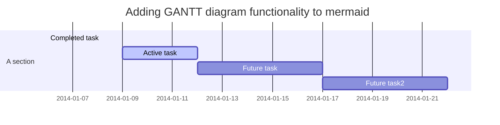

# MD Viewer - Chrome Markdown 预览插件

一个智能的 Chrome 浏览器扩展，能够自动检测并预览浏览器中打开的 Markdown 文件，支持源码与渲染视图的无缝切换。采用 Vite 构建，核心解析库本地化，Mermaid 图表支持在线加载。

## 📋 目录

- [功能特性](#功能特性)
- [项目结构](#项目结构)
- [环境要求](#环境要求)
- [快速开始](#快速开始)
- [使用说明](#使用说明)
- [配置说明](#配置说明)
- [开发指南](#开发指南)
- [常见问题](#常见问题)
- [技术栈](#技术栈)
- [许可证](#许可证)

---

## ✨ 功能特性

### 核心功能

- 🔍 **自动检测**：自动识别浏览器中打开的 `.md` 和 `.markdown` 文件
- 👁️ **实时预览**：即时渲染 Markdown 内容为美观的 HTML 页面
- 📝 **双模式切换**：一键在预览模式和源码模式之间切换
- 📋 **复制功能**：快速复制 Markdown 源码到剪贴板
- 💾 **下载功能**：下载原始 Markdown 文件
- 🔒 **安全防护**：使用 DOMPurify 防止 XSS 攻击
- 📑 **智能目录**：左侧自动生成导航栏，点击可平滑滚动定位
- ✏️ **实时编辑**：支持在线修改 Markdown 内容，并提供重置功能
- 📊 **Mermaid 支持**：自动渲染流程图、时序图等 Mermaid 图表（需联网）
- 🔢 **数学公式**：支持 KaTeX 渲染行内和块级数学公式
- 🌓 **主题切换**：支持亮色/暗色模式一键切换，并自动记忆用户偏好

### v1.4.0 新增功能

- 📄 **导出 PDF**：支持将 Markdown 预览内容导出为 PDF 文件
- 🔢 **代码块行号**：支持在代码块左侧显示行号，可通过设置开关控制
- 📑 **目录折叠/展开**：支持折叠/展开目录节点，可通过设置开关控制
- 💾 **自动保存草稿**：编辑时自动保存草稿到本地，下次进入编辑可恢复
- ⚙️ **设置菜单**：新增设置弹窗，可配置代码块行号、目录折叠、自动保存等选项
- 🔍 **图片点击放大**：支持点击图片查看大图（Lightbox）
- 🐛 **修复插件影响其他页面滚动条的 bug**：全局样式改为 JS 动态注入，避免影响非 Markdown 页面

### v1.3.0 新增功能

- 🖼️ **截图功能**：支持自动截图和手动选框截图，一键保存 PNG
- 🔍 **文档搜索**：支持 Ctrl+F 快速搜索文档内容，高亮匹配并定位跳转
- 📋 **最近文件**：自动记录最近打开的 Markdown 文件，支持二级菜单快速切换
- ⌨️ **快捷键说明**：支持 Ctrl+/ 查看所有可用快捷键

### 增强交互功能

每个代码块、表格和 Mermaid 图表都配备了顶部工具栏，提供丰富的操作选项。

#### 代码块工具栏

每个代码块顶部显示常驻工具栏：
- 🏷️ **语言标签**：自动显示代码语言（如 `JAVASCRIPT`、`PYTHON`）
- 🔄 **源码切换**：一键切换渲染视图和原始 Markdown 源码
- 📋 **复制 MD**：以标准 Markdown 格式（含 `\`\`\`语言 ` 标记）复制到剪贴板
- 📄 **复制代码**：复制纯代码内容到剪贴板

#### 表格工具栏

每个表格顶部显示常驻工具栏：
- 🏷️ **类型标签**：显示 `Table` 标签
- 🔄 **源码切换**：切换渲染表格和原始 Markdown 源码
-  **复制**：复制表格原始 Markdown 源码到剪贴板
- 📥 **下载 CSV**：将表格数据导出为 CSV 文件
- 📊 **下载 Excel**：将表格数据导出为 Excel 文件

#### Mermaid 图表工具栏

每个 Mermaid 图表顶部显示常驻工具栏：
- 🏷️ **类型标签**：显示 `Mermaid` 标签
- 🔄 **源码切换**：切换渲染图表和原始 Markdown 源码
- 📋 **复制 MD**：复制 `\`\`\`mermaid ` 源码到剪贴板
- 📥 **下载下拉菜单**：鼠标悬浮显示下载选项
  - 🖼️ **下载 PNG**：导出为高清 PNG 图片（白色背景，2 倍清晰度）
  -  **下载 SVG**：导出为 SVG 矢量图

- ✅ 标题（H1-H6）
- ✅ 粗体、斜体、删除线
- ✅ 无序列表、有序列表、任务列表
- ✅ 代码块（行内和多行，支持语法高亮样式）
- ✅ 链接和图片
- ✅ 引用块
- ✅ 表格
- ✅ 分隔线
- ✅ 嵌套列表
- ✅ **Mermaid 图表**（流程图、甘特图、类图等）

### 用户体验

- 🎨 **现代化界面**：渐变色工具栏，清晰的视觉层次
- 📱 **响应式设计**：完美适配桌面端和移动端
- ⚡ **零配置**：安装即可使用，无需任何设置
- 🚀 **轻量级**：核心体积小，加载速度快

---

## 📁 项目结构

```
md-view/
├── package.json              # 项目配置文件（依赖、脚本等）
├── vite.config.js            # Vite 构建配置
├── build-crx.js              # .crx 打包脚本（签名生成安装包）
├── README.md                 # 项目说明文档
├── index.html                # 开发测试页面（本地调试用）
├── public/                   # 静态资源目录
│   ├── manifest.json         # Chrome 插件清单文件 (Manifest V3)
│   ├── icons/                # 插件图标
│   │   ├── icon16.png        # 16x16 图标
│   │   ├── icon48.png        # 48x48 图标
│   │   └── icon128.png       # 128x128 图标
│   └── libs/                 # 第三方库（本地打包）
│       ├── mermaid.min.js    # Mermaid 图表库
│       ├── katex.min.js      # KaTeX 数学公式库
│       ├── katex.min.css     # KaTeX 样式文件
│       └── auto-render.min.js # KaTeX 自动渲染插件
├── src/                      # 源代码目录
│   ├── content.js            # 内容脚本（核心逻辑 ~2800 行）
│   ├── content.css           # 样式文件（亮/暗色主题）
│   ├── dev-main.js           # 开发模式入口（测试页面用）
│   └── modules/              # 功能模块（v1.3.0+ 新增）
│       ├── screenshot.js     # 截图模块（自动截图 + 手动选框截图）
│       ├── recent-files.js   # 最近文件管理模块
│       ├── shortcuts.js      # 快捷键说明弹窗模块
│       └── settings.js       # 设置管理模块（v1.4.0 新增）
├── dist/                     # Chrome 扩展构建输出目录
├── dist-web/                 # 网页版本（本地 file:// 协议使用）
├── dist-web-server/          # 网页版本（服务器部署使用）
└── release/                  # .crx 打包输出目录
    ├── key.pem               # RSA 签名私钥（务必保存好）
    └── md-viewer-v1.0.0.crx  # 可直接安装到 Chrome 的扩展包
```

### 关键文件说明

| 文件 | 作用 | 说明 |
|------|------|------|
| `manifest.json` | 插件配置清单 | 定义插件权限、入口点、图标等 |
| `content.js` | 内容脚本 | 自动检测 .md 文件并渲染 |
| `content.css` | 样式文件 | 定义工具栏和预览界面样式 |
| `vite.config.js` | 构建配置 | 配置 Vite 打包输出 |
| `package.json` | 项目配置 | 管理依赖和构建脚本 |
| `build-crx.js` | 打包脚本 | 将 dist/ 签名打包为 .crx 安装包 |
| `dev-main.js` | 开发入口 | 开发测试页面入口，模拟插件环境 |

---

## 💻 环境要求

### 系统要求

- **操作系统**：Windows 10/11, macOS, Linux
- **浏览器**：Google Chrome 88+ 或基于 Chromium 的浏览器（Edge, Brave 等）

### 开发环境

- **Node.js**：>= 16.0.0
- **npm**：>= 7.0.0 或 yarn >= 1.22.0

### 运行时依赖

本项目通过 `npm` 管理核心依赖，构建时会自动打包进扩展程序中：

- `marked@^11.1.0`：Markdown 解析器（本地打包）
- `dompurify@^3.0.6`：HTML sanitization 库（本地打包）
- `mermaid@10.x`：图表渲染库（**在线 CDN 加载**，以减小插件体积）
- `katex@0.16.x`：数学公式渲染库（本地打包）

---

## 🚀 快速开始

### 1. 克隆或下载项目

```bash
# 如果从 Git 仓库克隆
git clone <repository-url>
cd md-view

# 或直接解压下载的项目文件夹
cd F:\Protest\chromeplug\md-view
```

### 2. 安装依赖

```bash
npm install
```

### 3. 构建项目

```bash
npm run build
```

构建完成后，会在项目根目录生成 `dist/` 文件夹，包含所有编译后的文件。

### 3.1 其他构建命令

```bash
# 构建网页版本（服务器部署，输出到 dist-web-server/）
npm run build:web

# 构建网页版本（本地浏览器打开，输出到 dist-web/）
npm run build:web:local

# 仅构建扩展版本（输出到 dist/）
npm run build:ext

# 重新构建并打包 .crx（先构建扩展版本，再打包为 .crx 和 .zip）
npm run build:crx

# 一键构建并打包（先构建，再打包为 .crx 和 .zip）
npm run build:pack
```

**构建模式说明**：

| 命令 | 输出目录 | 路径类型 | 用途 |
|------|---------|---------|------|
| `npm run build` | `dist/` | 相对路径 `./` | Chrome 扩展 + 网页版 |
| `npm run build:web` | `dist-web-server/` | 绝对路径 `/` | **服务器部署**（Nginx/GitHub Pages） |
| `npm run build:web:local` | `dist-web/` | 相对路径 `./` | **本地 file:// 协议直接打开** |
| `npm run build:ext` | `dist/` | 相对路径 `./` | 仅 Chrome 扩展 |

> 📖 **详细构建文档**: 查看 [BUILD_COMMANDS.md](BUILD_COMMANDS.md) 了解完整的构建流程、技术实现和最佳实践。

### 4. 加载到 Chrome

1. 打开 Chrome 浏览器，访问 `chrome://extensions/`
2. 开启右上角的 **"开发者模式"** 开关
3. 点击左上角的 **"加载已解压的扩展程序"** 按钮
4. 选择项目中的 `dist` 目录（例如：`F:\Protest\chromeplug\md-view\dist`）
5. 插件加载成功，会在扩展列表中显示 "MD Viewer"

### 5. 测试插件

创建一个测试文件 `test.md`：

```markdown
# 欢迎使用 MD Viewer

这是一个 **Markdown** 测试文档。

## 功能演示

- ✅ 自动检测 .md 文件
- ✅ 实时预览渲染
- ✅ 源码/预览切换
- ✅ Mermaid 图表支持

## Mermaid 示例



> 这是一个引用块

| 功能 | 状态 |
|------|------|
| 预览 | ✅ |
| 编辑 | ✅ |
```

在浏览器中打开该文件：

```
file:///你的路径/test.md
```

插件会自动识别并渲染！

### 6. 开发模式测试

```bash
npm run dev
```

启动后访问 `http://localhost:5173`，在页面中通过以下方式预览 Markdown：

- **选择文件**：点击"选择文件"按钮，选择本地 `.md` 文件
- **拖拽上传**：将 `.md` 文件拖拽到页面中
- **内置示例**：点击页面下方的示例链接，快速查看渲染效果

---

## 📖 使用说明

### 基本使用

#### 1. 自动预览

当你在浏览器中打开任何 `.md` 或 `.markdown` 文件时，插件会自动：

- 检测文件类型
- 解析 Markdown 内容
- 渲染为 HTML 预览视图
- 显示顶部工具栏和左侧目录（如果有标题）

#### 2. 切换视图模式

顶部工具栏提供四个按钮：

| 按钮 | 功能 | 快捷键 |
|------|------|--------|
| 👁️ **预览** | 切换到渲染后的 HTML 预览视图 | - |
| 📝 **源码** | 切换到原始 Markdown 文本视图 | - |
| 📋 **复制** | 复制 Markdown 源码到剪贴板 | - |
| 💾 **下载** | 下载原始 .md 文件 | - |
| ✏️ **编辑** | 进入实时编辑模式 | - |
| ↩️ **重置** | 恢复文件原始内容 | - |
| 🌓 主题 | 切换亮色/暗色界面主题 | - |

**操作步骤**：

1. 点击 "👁️ 预览" 或 "📝 源码" 按钮切换视图
2. 当前激活的模式会高亮显示
3. 文件名显示在工具栏右侧

#### 3. 使用目录导航

- 如果文档包含 H1-H3 标题，左侧会自动生成目录。
- **点击目录项**，右侧内容会自动平滑滚动到对应位置。

#### 4. 实时编辑

1. 点击 "✏️ 编辑" 按钮进入编辑模式。
2. 在文本框中修改内容，右侧预览会**实时同步更新**（有 500ms 延迟以防卡顿）。
3. 点击 "✅ 完成" 退出编辑模式。
4. 如果改乱了，点击 "↩️ 重置" 恢复原样。

#### 5. 使用代码块工具栏

每个代码块右上角会显示工具栏：

1. 查看语言标签，确认代码类型
2. 点击 **"源码"** 按钮查看原始 Markdown 代码
3. 点击 **"复制 MD"** 以标准 Markdown 格式复制到剪贴板（含 `\`\`\`语言名` 标记）
4. 点击 **"复制"** 复制纯代码内容

#### 6. 使用表格工具栏

每个表格右上角会显示工具栏：

1. 点击 **"源码"** 按钮查看原始 Markdown 表格源码
2. 点击 **"复制"** 将表格源码复制到剪贴板
3. 点击 **"下载 CSV"** 导出为 CSV 文件
4. 点击 **"下载 Excel"** 导出为 Excel 文件

#### 7. 使用 Mermaid 图表工具栏

每个 Mermaid 图表右上角会显示工具栏：

1. 点击 **"源码"** 按钮查看原始 Mermaid 代码
2. 点击 **"复制 MD"** 复制 `\`\`\`mermaid ` 源码到剪贴板
3. 点击 **"下载"** 按钮展开下拉菜单：
   - 选择 **"PNG"** 导出为高清 PNG 图片（白色背景）
   - 选择 **"SVG"** 导出为 SVG 矢量图

### 高级用法

#### 从 GitHub/GitLab 预览

直接在浏览器中打开 GitHub 上的 raw 文件链接：

```
https://raw.githubusercontent.com/user/repo/main/README.md
```

插件会自动渲染预览。

#### 本地服务器预览

如果你使用本地服务器（如 Live Server、http-server）：

```bash
# 安装 http-server
npm install -g http-server

# 启动服务器
http-server .

# 访问
http://localhost:8080/document.md
```

#### 拖拽文件到浏览器

直接将 `.md` 文件拖拽到 Chrome 窗口中，插件会自动渲染。

---

## ⚙️ 配置说明

### manifest.json 配置

```json
{
  "manifest_version": 3,
  "name": "MD Viewer - Markdown Preview",
  "version": "1.0.0",
  "description": "自动检测并预览浏览器中打开的 Markdown 文件",
  "permissions": [
    "activeTab",
    "scripting"
  ],
  "content_scripts": [
    {
      "matches": ["<all_urls>"],
      "js": ["content.js"],
      "css": ["content.css"],
      "run_at": "document_end"
    }
  ]
}
```

#### 关键配置项说明

| 配置项 | 值 | 说明 |
|--------|-----|------|
| `manifest_version` | `3` | 使用 Manifest V3（最新版） |
| `permissions` | `activeTab`, `scripting` | 需要访问当前标签页和执行脚本 |
| `content_scripts.matches` | `<all_urls>` | 在所有网页中注入脚本 |
| `content_scripts.run_at` | `document_end` | 在 DOM 加载完成后执行 |

### 自定义配置

#### 修改功能开关

在 `src/content.js` 顶部修改 `CONFIG` 对象：

```javascript
const CONFIG = {
  enableTOC: true,      // 关闭则不显示左侧目录
  enableMermaid: true,  // 关闭则不渲染 Mermaid 图表
  enableEditor: true,   // 关闭则不显示编辑按钮
  enableMath: true      // 关闭则不渲染数学公式
};
```
### 图标配置

准备三个 PNG 图标文件放置在 `public/icons/` 目录：

- `icon16.png`：16x16 像素（扩展程序列表显示）
- `icon48.png`：48x48 像素（扩展程序管理页面显示）
- `icon128.png`：128x128 像素（Chrome Web Store 使用）

**图标设计建议**：

- 使用简洁的 "M" 或 "MD" 字母
- 背景透明或纯色
- 确保在小尺寸下清晰可辨

可以使用在线工具生成：
- [favicon.io](https://favicon.io/)
- [realfavicongenerator.net](https://realfavicongenerator.net/)

---

## 🛠️ 开发指南

### 开发模式

虽然本项目使用 Vite 构建，但由于是 Chrome 扩展，建议使用以下工作流：

#### 1. 实时开发

```bash
# 启动开发模式（本地测试页面，支持热更新）
npm run dev
```

或者手动构建：

```bash
# 每次修改后重新构建
npm run build

# 监视文件变化并自动重新构建
npm run build -- --watch
```

#### 2. 重新加载插件

在 Chrome 中：

1. 访问 `chrome://extensions/`
2. 找到 "MD Viewer" 扩展
3. 点击刷新图标 🔄（或按 `Ctrl+R` / `Cmd+R`）

#### 3. 调试内容脚本

1. 打开任意 `.md` 文件
2. 按 `F12` 打开开发者工具
3. 在 Console 中查看日志输出

```javascript
// 在 content.js 中添加调试日志
console.log('Markdown detected:', isMarkdownFile());
console.log('Raw content:', rawText);
```

### 代码结构详解

#### content.js 核心流程

```javascript
// 1. 检测是否为 Markdown 文件
isMarkdownFile()
  ↓
// 2. 获取原始文本内容
getRawText()
  ↓
// 3. 创建 UI 界面
createUI()
  ↓
// 4. 解析 Markdown 为 HTML (使用 import 导入的库)
parseMarkdown(text)
  ↓
// 5. 渲染到页面
renderMarkdown()
  ↓
// 6. 绑定事件处理
bindEvents()
```

#### 关键函数说明

| 函数名 | 作用 | 返回值 |
|--------|------|--------|
| `isMarkdownFile()` | 检测当前页面是否为 MD 文件 | `boolean` |
| `getRawText()` | 提取页面中的原始文本 | `string` |
| `parseMarkdown(text)` | 将 Markdown 解析为 HTML | `string` |
| `createUI()` | 创建工具栏和容器 | `Object` |
| `renderMarkdown()` | 主渲染函数 | `void` |
| `bindEvents()` | 绑定按钮事件 | `void` |

### 构建流程

#### 扩展版本构建

```bash
npm run build:ext
```

**构建步骤**：

1. Vite 读取 `vite.config.js` 配置
2. 处理 `src/content.js` 和 `src/content.css`
3. 复制 `public/` 目录到 `dist/`（包含 manifest.json）
4. 输出最终文件到 `dist/` 目录

**输出结构**：

```
dist/
├── manifest.json         # Chrome 扩展清单
├── content.js            # 内容脚本
├── content.css           # 样式文件
├── main.js               # 开发测试入口
├── icons/                # 图标
└── libs/                 # 第三方库
```

#### 网页版本构建

**本地版本**（file:// 协议）：
```bash
npm run build:web:local
# 输出到 dist-web/，CSS 使用相对路径 ./
```

**服务器版本**（HTTP 部署）：
```bash
npm run build:web
# 输出到 dist-web-server/，CSS 使用绝对路径 /
```

**技术细节**：
- `index.html` 源文件不包含 CSS 引用
- Vite 插件 `webModeHtmlPlugin` 在构建时动态注入 CSS
- `webModeAssetsPlugin` 精确复制 `libs/` 和 `icons/`，排除 `manifest.json`

### 发布到 Chrome Web Store

#### 1. 准备发布

```bash
# 确保版本号正确
# 编辑 manifest.json 中的 version 字段

# 构建生产版本
npm run build
```

#### 2. 打包扩展

**方式一：一键打包 .crx（推荐）**

```bash
# 先构建项目，再打包为 .crx 安装包
npm run build:pack
```

执行后会在 `release/` 目录下生成：
- `md-viewer-v{version}.crx` — 可直接拖拽安装到 Chrome
- `key.pem` — 签名私钥（务必保存好，更新版本时复用可保持扩展 ID 一致）

**方式二：手动打包为 zip（用于 Chrome Web Store）**

```bash
# 压缩 dist 目录为 zip 文件
cd dist
zip -r ../md-viewer.zip .
```

或在 Windows 上：

```powershell
Compress-Archive -Path dist\* -DestinationPath md-viewer.zip
```

#### 3. 安装 .crx 到 Chrome

`.crx` 文件生成后，有以下几种安装方式：

**方式一：加载已解压的扩展程序（推荐，开发调试使用）**

1. 打开 Chrome，访问 `chrome://extensions/`
2. 右上角开启 **开发者模式**
3. 点击 **"加载已解压的扩展程序"**
4. 选择项目的 `dist/` 文件夹

> 每次修改代码后运行 `npm run build`，然后点击扩展卡片上的刷新按钮即可更新。

**方式二：拖拽安装 .crx（需要配置注册表）**

Chrome 67+ 默认禁止非 Chrome Web Store 的 .crx 拖拽安装。Windows 用户可通过注册表配置允许：

```cmd
# 以管理员身份运行 cmd，执行以下命令
reg add "HKEY_LOCAL_MACHINE\SOFTWARE\Policies\Google\Chrome\ExtensionInstallSources" /v 1 /t REG_SZ /d "file:///" /f
```

配置后重启 Chrome，访问 `chrome://extensions/`，开启开发者模式，直接拖拽 `release/md-viewer-v{version}.crx` 到扩展页面即可安装。

**方式三：命令行安装（企业环境）**

```bash
# 关闭所有 Chrome 窗口后执行
"C:\Program Files\Google\Chrome\Application\chrome.exe" --install-extension="release/md-viewer-v1.0.0.crx"
```

#### 4. 上传到 Chrome Web Store

1. 访问 [Chrome Web Store Developer Dashboard](https://chrome.google.com/webstore/devconsole/)
2. 点击 "新增项目"
3. 上传 `md-viewer.zip`
4. 填写详细信息（描述、截图、分类等）
5. 提交审核

#### 5. 审核注意事项

- 提供清晰的截图和演示视频
- 详细说明隐私政策（本插件不收集任何数据）
- 确保符合 [Chrome Web Store 政策](https://developer.chrome.com/docs/webstore/program_policies/)

---

## ❓ 常见问题

### Q1: 点击左侧目录没有反应？

**原因**：通常是由于浏览器安全策略或代码逻辑问题。
**解决**：请确保你使用的是最新版本的代码，我们已改用事件委托（Event Delegation）来处理目录点击，兼容性更好。

### Q2: Mermaid 图表不显示？

**原因**：Mermaid 库是通过 CDN 在线加载的。
**解决**：
1. 检查网络连接是否正常。
2. 确认代码块语言标记为 `mermaid`（例如：```mermaid）。
3. 检查浏览器控制台（F12）是否有加载错误。

### Q3: 插件没有自动渲染 Markdown 文件？

**可能原因**：

1. **文件扩展名不正确**：确保文件以 `.md` 或 `.markdown` 结尾
2. **Content-Type 不匹配**：某些服务器可能返回错误的 MIME 类型
3. **插件未启用**：检查 `chrome://extensions/` 中插件是否已启用
### Q3: 如何禁用插件对特定网站的检测？

**解决方案**：

在 `manifest.json` 中排除特定域名：

```json
{
  "content_scripts": [
    {
      "matches": ["<all_urls>"],
      "exclude_matches": [
        "*://github.com/*",
        "*://gitlab.com/*"
      ],
      "js": ["content.js"],
      "css": ["content.css"]
    }
  ]
}
```

### Q4: 如何在本地测试不同场景？

**创建测试服务器**：

```bash
# 安装 http-server
npm install -g http-server

# 在项目根目录创建 test-files 文件夹
mkdir test-files

# 放入各种测试文件
echo "# Test" > test-files/test.md

# 启动服务器
http-server test-files -p 8080

# 访问
http://localhost:8080/test.md
```

### Q5: 插件影响页面性能吗？

**回答**：

- ✅ **仅在 .md 文件中激活**：非 Markdown 页面不会执行任何操作
- ✅ **本地化依赖**：库文件随扩展打包，无网络请求延迟
- ✅ **一次性执行**：渲染完成后不再占用资源

**性能优化建议**：

```javascript
// 添加缓存机制
const markdownCache = new Map();

function parseMarkdown(text) {
  if (markdownCache.has(text)) {
    return markdownCache.get(text);
  }
  
  const html = marked.parse(text);
  markdownCache.set(text, html);
  return html;
}
```

---

## 🧰 技术栈

### 核心技术

| 技术 | 版本 | 用途 |
|------|------|------|
| **Manifest V3** | 3.0 | Chrome 扩展最新标准 |
| **Content Scripts** | - | 注入网页的 JavaScript |
| **Vite** | 4.4.9 | 前端构建工具 |

### 依赖库

| 库 | 版本 | 用途 | 来源 |
|----|------|------|------|
| **marked** | ^11.1.0 | Markdown 解析器 | npm 本地打包 |
| **DOMPurify** | ^3.0.6 | HTML 安全过滤 | npm 本地打包 |
| **Mermaid** | 10.x | 图表渲染 | **在线 CDN** |

### 为什么选择这些技术？

- **Manifest V3**：Google 推荐的最新扩展标准，更好的安全性和性能
- **marked**：最流行的 JavaScript Markdown 解析器，速度快，兼容性好
- **DOMPurify**：业界标准的 HTML sanitization 库，防止 XSS 攻击
- **Vite**：快速的构建工具，支持热更新和模块化，能完美处理 ESM 依赖

### 架构设计

```
用户打开 .md 文件
    ↓
Content Script 注入
    ↓
检测文件类型 (isMarkdownFile)
    ↓
提取原始文本 (getRawText)
    ↓
创建 UI 界面 (createUI)
    ↓
使用本地打包的 marked + DOMPurify 解析
    ↓
渲染 HTML (renderMarkdown)
    ↓
绑定交互事件 (bindEvents)
    ↓
用户可查看/复制/下载
```

---

## 📄 许可证

本项目采用 **MIT 许可证**。

```
MIT License

Copyright (c) 2026 MD Viewer Contributors

Permission is hereby granted, free of charge, to any person obtaining a copy
of this software and associated documentation files (the "Software"), to deal
in the Software without restriction, including without limitation the rights
to use, copy, modify, merge, publish, distribute, sublicense, and/or sell
copies of the Software, and to permit persons to whom the Software is
furnished to do so, subject to the following conditions:

The above copyright notice and this permission notice shall be included in all
copies or substantial portions of the Software.

THE SOFTWARE IS PROVIDED "AS IS", WITHOUT WARRANTY OF ANY KIND, EXPRESS OR
IMPLIED, INCLUDING BUT NOT LIMITED TO THE WARRANTIES OF MERCHANTABILITY,
FITNESS FOR A PARTICULAR PURPOSE AND NONINFRINGEMENT. IN NO EVENT SHALL THE
AUTHORS OR COPYRIGHT HOLDERS BE LIABLE FOR ANY CLAIM, DAMAGES OR OTHER
LIABILITY, WHETHER IN AN ACTION OF CONTRACT, TORT OR OTHERWISE, ARISING FROM,
OUT OF OR IN CONNECTION WITH THE SOFTWARE OR THE USE OR OTHER DEALINGS IN THE
SOFTWARE.
```

---

## 🤝 贡献指南

欢迎贡献代码、报告问题或提出建议！

### 贡献步骤

1. **Fork 本仓库**
2. **创建功能分支**：`git checkout -b feature/AmazingFeature`
3. **提交更改**：`git commit -m 'Add some AmazingFeature'`
4. **推送到分支**：`git push origin feature/AmazingFeature`
5. **提交 Pull Request**

### 代码规范

- 使用 ESLint 进行代码检查
- 遵循 JavaScript 标准风格
- 添加必要的注释
- 确保新功能有相应的测试

### 报告问题

请在 [Issues](https://github.com/your-repo/md-viewer/issues) 中报告问题，包括：

- 问题描述
- 复现步骤
- 预期行为
- 实际行为
- 浏览器版本
- 截图（如有）

---

## 📞 联系方式

- **项目主页**：[GitHub Repository](https://github.com/your-repo/md-viewer)
- **问题反馈**：[Issues](https://github.com/your-repo/md-viewer/issues)
- **邮箱**：your-email@example.com

---

## 🙏 致谢

感谢以下开源项目的支持：

- [marked](https://github.com/markedjs/marked) - Markdown 解析器
- [DOMPurify](https://github.com/cure53/DOMPurify) - HTML sanitization
- [Vite](https://vitejs.dev/) - 前端构建工具
- Chrome Extension API 文档

---

## 📊 更新日志

### v1.4.0 (2026-10-20)

**新增功能**

- 📄 **导出 PDF**：支持将 Markdown 预览内容导出为 PDF 文件
- 🔢 **代码块行号显示**：在代码块左侧显示行号，可通过设置开关控制（默认关闭）
- 📑 **目录折叠/展开**：支持折叠/展开目录节点，可通过设置开关控制（默认开启）
- 💾 **自动保存草稿**：编辑时自动保存草稿到本地，下次进入编辑可恢复（默认关闭）
- ⚙️ **设置菜单**：新增设置弹窗，可配置代码块行号、目录折叠、自动保存等选项
- 🔍 **图片点击放大**：支持点击图片查看大图（Lightbox）
- 🐛 **修复插件影响其他页面滚动条的 bug**：全局样式改为 JS 动态注入，避免影响非 Markdown 页面

**代码结构优化**

- 新增 settings.js 设置管理模块
- 代码块行号动态对齐（继承代码块实际 line-height 和 font-size）

### v1.3.0 (2026-10-16)

**新增功能**

- ✅ 新增"更多"下拉菜单：自动截图、手动截图、搜索、快捷键、最近文件
- ✅ 新增自动截图功能：一键截取当前 Markdown 预览内容
- ✅ 新增手动选框截图：拖动选框自定义截图区域，支持保存、取消、重新选择
- ✅ 新增文档搜索功能：支持 Ctrl+F 快速搜索文档内容，高亮匹配项并支持定位跳转
- ✅ 新增最近文件管理：自动记录最近打开的 Markdown 文件，支持二级菜单快速切换
- ✅ 新增快捷键说明弹窗：支持 Ctrl+/ 查看所有可用快捷键
- ✅ 新增全屏模式下 toolbar 悬停显示（鼠标移入顶部自动滑出）
- ✅ 修复搜索点击项定位问题（通过 data-search-index 精确匹配）
- ✅ 修复最近文件切换后内容不更新问题
- ✅ html2canvas 改为动态加载，减小 content.js 体积（减小约 198KB）
- ✅ 优化外层滚动条问题（html/body 添加 overflow: hidden）

**代码结构优化**

- 功能模块化拆分：screenshot.js、recent-files.js、shortcuts.js
- 开发/生产环境统一适配

### v1.2.0 (2026-07-22)

**功能增强**

- ✅ 新增代码块顶部工具栏：语言标签、源码/渲染切换、复制 MD、复制代码
- ✅ 新增表格顶部工具栏：源码/渲染切换、复制、下载 CSV、下载 Excel
- ✅ 新增 Mermaid 图表顶部工具栏：源码/渲染切换、复制 MD、下载 PNG/SVG
- ✅ 优化 PNG 导出清晰度（支持 devicePixelRatio 缩放）
- ✅ 修复源码切换空白问题

### v1.1.0 (2026-05-27)

**功能增强**

- ✅ 新增左侧目录导航（TOC），支持点击平滑滚动
- ✅ 新增 Mermaid 图表支持（流程图、时序图等）
- ✅ 新增实时编辑功能，支持一键重置
- ⚡ 优化打包体积，Mermaid 改为在线加载

### v1.0.0 (2026-05-22)

**首次发布**

- ✅ 自动检测 `.md` 和 `.markdown` 文件
- ✅ 实时 Markdown 预览渲染
- ✅ 源码/预览双模式切换
- ✅ 复制和下载功能
- ✅ 响应式设计
- ✅ 安全防护（XSS 过滤）
**未来计划**：

- ✅ v1.1.0：添加主题切换（亮色/暗色）
- ✅ v1.2.0：支持数学公式渲染
- ✅ v1.3.0：代码块/表格/Mermaid 交互工具栏
- 📅 v2.0.0：添加内置编辑器
---

**⭐ 如果这个项目对你有帮助，请给个 Star！**

# 数学公式测试

## 行内公式
这是一个著名的质能方程：$E=mc^2$。

## 块级公式
二次方程求根公式：

$$
x = \frac{-b \pm \sqrt{b^2 - 4ac}}{2a}
$$

## 复杂公式
麦克斯韦方程组（微分形式）：

$$
\begin{aligned}
\nabla \cdot \mathbf{E} &= \frac{\rho}{\varepsilon_0} \\
\nabla \cdot \mathbf{B} &= 0 \\
\nabla \times \mathbf{E} &= -\frac{\partial \mathbf{B}}{\partial t} \\
\nabla \times \mathbf{B} &= \mu_0\mathbf{J} + \mu_0\varepsilon_0\frac{\partial \mathbf{E}}{\partial t}
\end{aligned}
$$

# Mermaid 测试
## 流程图


## 时序图


## 甘特图
